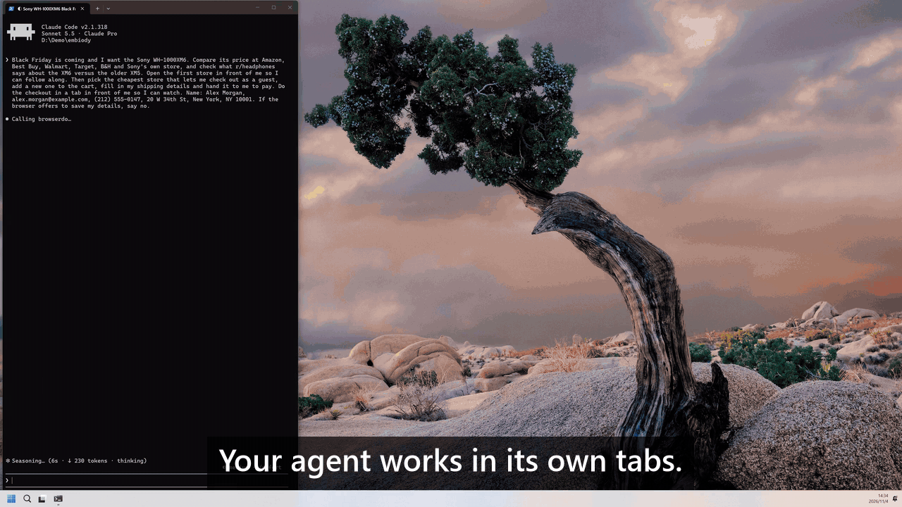
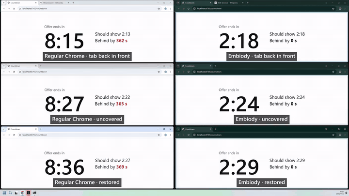
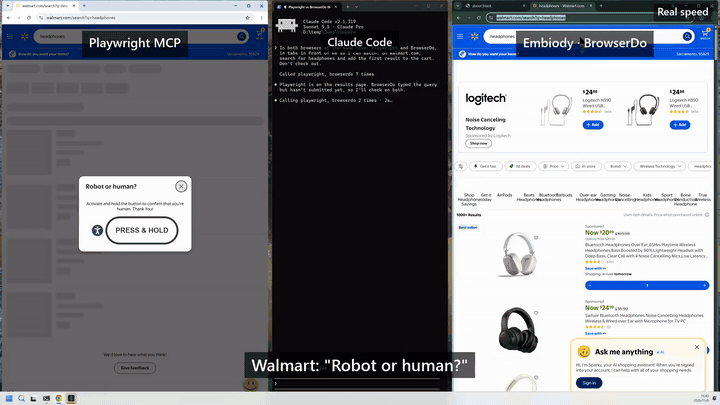
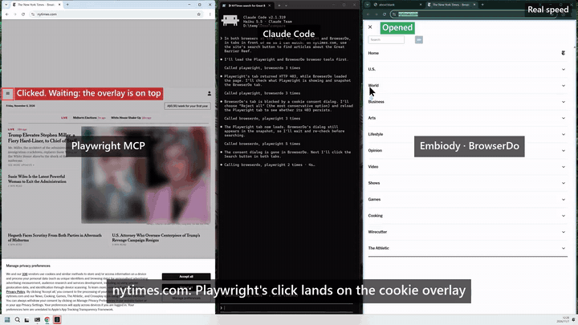
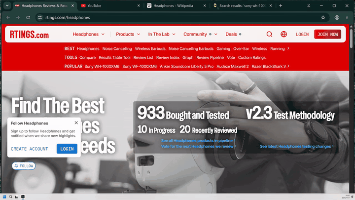
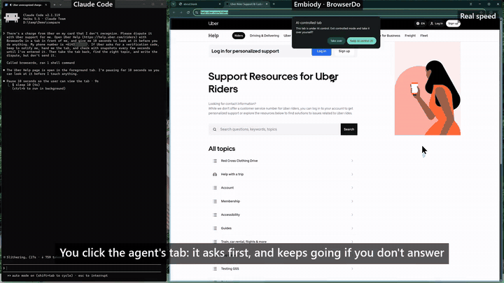
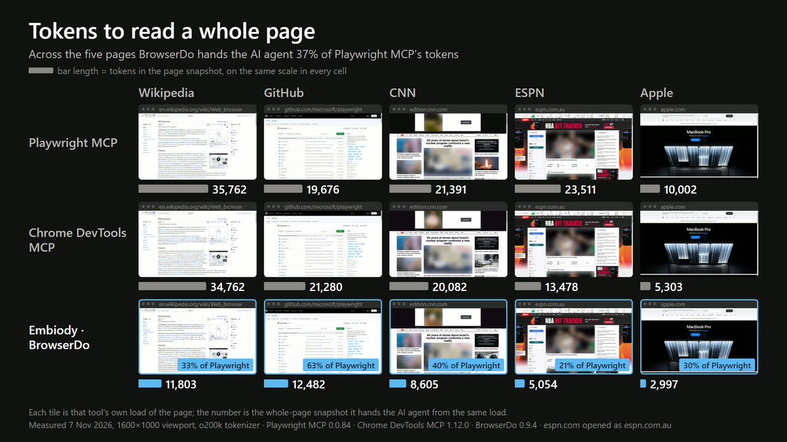
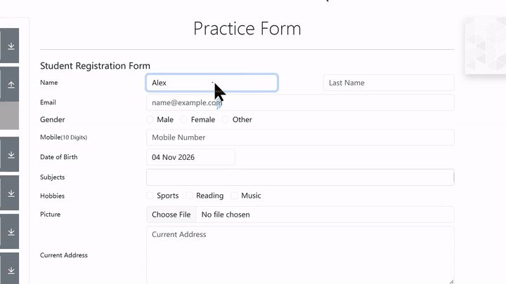
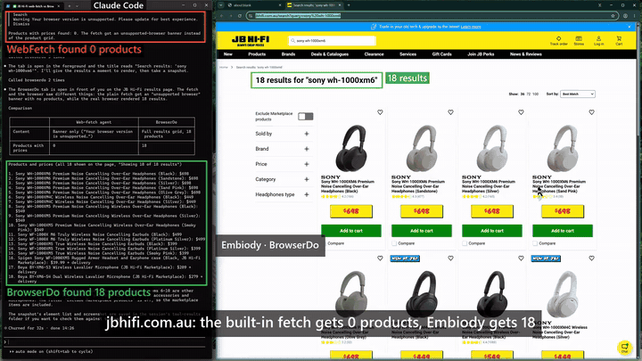
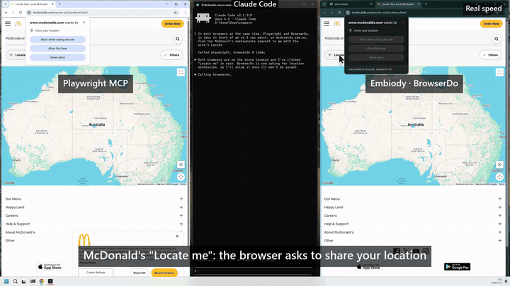

# BrowserDo

[](https://mcpservers.org/servers/zhaijunlong/browserdo)

[](https://youtu.be/hIqfkx8bA98)

**Built for AI agents. Shared with people.**

[Embiody](https://embiody.com) is a Windows browser your AI agent works in, in the background and
at full speed, while you keep using your PC and can step in at any time. BrowserDo is the
[MCP](https://modelcontextprotocol.io) server that connects your agent to it. Add it to Claude
Code, Claude Desktop, Codex, Cursor, VS Code or Gemini CLI, and your agent can browse, click, type
and read pages, including sites you are signed in to.

## Why BrowserDo

Each point below has a short clip recorded on real sites. The side-by-side ones run the same task
at the same moment through Playwright MCP and BrowserDo, from one Claude Code session.

### 1. Works in the background at full speed, and leaves your screen to you

[](https://embiody.com/assets/video/points/point-01.mp4)
*Chrome and Embiody countdowns in a background tab, behind a window and minimized. Click for the 38-second clip.*

Pages run at full speed in background tabs, background windows, minimized windows and hidden
windows. Your agent does not need the browser in front of you, so you keep using your computer
while it works, and it can work in a dozen tabs at once.

Ordinary Chrome slows down pages you are not looking at. In our test, a browser window was
completely covered by another window for 7 minutes:

| | Timers | A countdown on the page |
| --- | --- | --- |
| Embiody, front tab | 10 per second throughout | on time |
| Embiody, background tab | 10 per second throughout | on time |
| Chrome, front tab | slowed down after 12 seconds | 355 seconds behind |

No launch flags are needed for this. One limit: a page opened *while* its window is minimized
may come back without a screenshot; its text and element numbers are still there.

### 2. Works where bots get blocked — because it isn't one

[](https://embiody.com/assets/video/points/point-02.mp4)
*Walmart, Target, adidas and realtor.com stop Playwright MCP with a bot check; Embiody goes straight through. Click for the 24-second clip.*

Your agent works in your own browser, on your behalf, so sites with anti-bot protection treat it
the way they treat you. We also signed in to an account on a site protected by a leading
commercial bot-detection service, the kind that usually stops automation tools.

### 3. Sees the whole page and clicks the right thing

[](https://embiody.com/assets/video/points/point-03.mp4)
*On nytimes.com a privacy overlay swallows Playwright MCP’s click; BrowserDo gives the agent only the overlay’s buttons, so it closes it first. Click for the 28-second clip.*

- Elements covered by a popup or overlay get no number, so the agent can't click something you
  can't see.
- Content inside embedded frames from other sites, such as payment forms and sign-in boxes, can
  be read and clicked.
- Long pages are read whole, not only the part on screen.
- An element off screen is scrolled into view before it is clicked.
- Clicks land where they should across multiple monitors and at any display scaling.
- Every element number belongs to one snapshot. A number from an older snapshot is refused
  before anything is clicked, instead of hitting whatever took its place.

### 4. You can see what the agent is doing

[](https://embiody.com/assets/video/points/point-04.mp4)
*The "AI-controlled tab" badge, then the highlighted border and the agent’s own cursor. Click for the 15-second clip.*

A tab the agent is working in shows a virtual mouse pointer, a frame around the page and a
marker on the tab. Open it any time to watch.

### 5. You and the agent share one tab

[](https://embiody.com/assets/video/points/point-05.mp4)
*Disputing a charge on Uber Help: the agent hands you the tab for the sign-in code, then takes it back. Click for the 38-second clip.*

The agent fills in the forms; you step in for the sign-in code, the captcha or the payment, then
hand the tab back, and the agent picks up where you left off. If you click or type in a tab the
agent is working in, you are asked whether to take it over. The agent asks before it touches a
tab of yours.

### 6. Fewer tokens for the whole page

[](assets/readme/point-06-tokens.jpg)

The browser engine itself boils each page down for the agent: its text, plus every element the
agent can act on, numbered. On Wikipedia, GitHub, CNN, ESPN and Apple, a whole-page snapshot took
37% of the tokens of Playwright MCP's (o200k tokenizer, same 1600×1000 viewport, November 2026),
and the agent can read just the screen it is working on.

### 7. Several steps in one call

[](https://embiody.com/assets/video/points/point-07.mp4)
*Real speed: the agent fills 4 form fields in 2.5 seconds with one call. Click for the 3-second clip.*

`browser_batch` runs several actions (clicks, typing, key presses) in a row and returns a fresh
snapshot of the page, so the agent needs fewer round trips and fewer tokens.

### 8. Reads the page itself, not a summary

[](https://embiody.com/assets/video/points/point-08.mp4)
*A JB Hi-Fi search page: Claude Code’s built-in fetch gets a browser warning and 0 products; BrowserDo reads all 18 with prices. Click for the 30-second clip.*

`browser_read_pages` returns the page's own text, links included, from pages built by scripts and
from sites you are signed in to. It can stand in for Claude Code's WebFetch, which fetches the page
without running its scripts and hands back a short model-written summary.

### 9. Sees the browser's own popups

[](https://embiody.com/assets/video/points/point-09.mp4)
*McDonald’s store finder asks for your location: Playwright MCP’s agent never sees the prompt; BrowserDo reports it and the agent allows it once. Click for the 30-second clip.*

Permission bubbles, menus, Save As dialogs, "Leave site?" prompts and alerts are reported in every
snapshot, with the ways each one can be answered.

### 10. Current engine, signed releases

Built on Chromium 156. Releases are signed, and the browser updates itself, checking the
signature of every update.

## Requirements

- Windows 10 or 11, 64-bit (Embiody is Windows only for now)
- Node.js 20 or newer. Check with `node -v`. Without it, BrowserDo fails to start (Claude Code shows
  "Failed to connect"). Install it with `winget install OpenJS.NodeJS.LTS`, then restart your client.
- The Embiody browser, version 0.9.0.3 or newer: installed automatically the first time BrowserDo
  starts. That is a download of about 140 MB and takes a few minutes; your client can use BrowserDo
  at once, and until the browser is ready each tool replies with the progress. With an older one, BrowserDo opens the browser's update page and asks you to restart
  the browser and BrowserDo once it has updated ([details](docs/browser-versions.md)).

No API key is needed. Your agent drives the browser with its own model.

## Install

BrowserDo runs as `npx -y browserdo-mcp`. Pick your client and follow only that section; the others
are for other clients.

### Claude Code

```bash
claude mcp add browserdo -- npx -y browserdo-mcp
```

Add `--scope project` to share it with your team through `.mcp.json`, or `--scope user` to use it
in every project.

### Claude Desktop

Edit `%APPDATA%\Claude\claude_desktop_config.json`:

```json
{
  "mcpServers": {
    "browserdo": {
      "command": "npx",
      "args": ["-y", "browserdo-mcp"]
    }
  }
}
```

### Codex

```bash
codex mcp add browserdo -- npx -y browserdo-mcp
```

Or add to `~/.codex/config.toml`:

```toml
[mcp_servers.browserdo]
command = "npx"
args = ["-y", "browserdo-mcp"]
```

### Cursor

Add to `~/.cursor/mcp.json` (all projects) or `.cursor/mcp.json` (one project):

```json
{
  "mcpServers": {
    "browserdo": {
      "type": "stdio",
      "command": "npx",
      "args": ["-y", "browserdo-mcp"]
    }
  }
}
```

### VS Code

Run **MCP: Add Server** from the Command Palette, choose **Command (stdio)** and enter
`npx -y browserdo-mcp`. Or add to `.vscode/mcp.json`:

```json
{
  "servers": {
    "browserdo": {
      "type": "stdio",
      "command": "npx",
      "args": ["-y", "browserdo-mcp"]
    }
  }
}
```

### Gemini CLI

Add to `~/.gemini/settings.json` (all projects) or `.gemini/settings.json` (one project):

```json
{
  "mcpServers": {
    "browserdo": {
      "command": "npx",
      "args": ["-y", "browserdo-mcp"]
    }
  }
}
```

### Other MCP clients

Add a local (stdio) MCP server in your client's settings, with command `npx` and arguments
`-y browserdo-mcp`. Most clients take it in this shape:

```json
{
  "mcpServers": {
    "browserdo": {
      "command": "npx",
      "args": ["-y", "browserdo-mcp"]
    }
  }
}
```

Then ask your agent to do something on the web:

> Find me a direct flight from Sydney to Melbourne next Wednesday morning and show me the
> three cheapest options.

## Tools

Each tool is one browser action. `windowId` and `tabId` are optional everywhere; leave them out
and the frontmost window and tab are used.

| Tool | What it does |
| --- | --- |
| `browser_take_snapshot` | The page as one line per element, each actionable element with a number, plus the page position, URL, title, any popups in the way and a `snapshotId`. Says when the page is a PDF, an error page or a crashed tab. `includeImage` adds the annotated screenshot; `readWholePage` reads beyond the screen. |
| `browser_read_pages` | Read up to 10 pages at once in background tabs and get their text, with links as footnotes. |
| `browser_batch` | Several actions on one tab in a row, then a fresh snapshot. Stops at the first failure, and after a step that changed the page. |
| `browser_click`, `browser_input_text`, `browser_press_key`, `browser_select_editable_text`, `browser_scroll` | Act on an element by its number and the `snapshotId` it came from. `browser_input_text` can also edit at a place named by the surrounding words. |
| `browser_move`, `browser_drag` | Hover; press, carry and release. Drag works sliders, canvases and reorderable lists. |
| `browser_navigate`, `browser_go_back`, `browser_go_forward`, `browser_reload`, `browser_stop_loading`, `browser_wait` | Getting around. |
| `browser_get_window_info`, `browser_new_window`, `browser_close_window`, `browser_show`, `browser_minimize` | Windows. `browser_get_window_info` lists every window and tab with their ids. |
| `browser_new_tab`, `browser_select_tab`, `browser_close_tab`, `browser_set_audio_muted` | Tabs. |
| `browser_close_popup_bubble` | Answer a permission bubble or dialog. |
| `browser_start_human_control`, `browser_stop_human_control` | Hand the tab to a person for a password or captcha, then take it back. |
| `browser_status` | Whether the browser is ready, or how far its first install has got. |

## Settings

Set these in the `env` block of your client's config, or put them in a config file (copy
`browserdo.config.example.yaml` to `browserdo.config.yaml` next to where the server runs, or pass
`--config <path>`). Environment variables win over the config file.

| Variable | What it does |
| --- | --- |
| `EMBIODY_TOOLS` | `browser` (the tools above), `task` (`browser_run_task` only) or `all` (default). |
| `EMBIODY_SAVE_SNAPSHOTS` | `1` saves every snapshot's screenshots and page text under `run/browser_data`, for debugging. Off by default. |
| `EMBIODY_EXE_PATH` | Launch your own Embiody build, on a separate profile, instead of the installed one. |
| `EMBIODY_USER_DATA_DIR` | Give the agent a separate profile folder instead of your own Embiody; BrowserDo then starts a browser of its own on it. |
| `EMBIODY_VLLM_ENDPOINT`, `EMBIODY_VLLM_MODEL`, `EMBIODY_VLLM_API_KEY` | The model for `browser_run_task` (below). |

The example config file explains the rest: fallback models, timeouts, how long to let pages
settle. `--transport sse` serves MCP over HTTP at `http://127.0.0.1:3000/sse` instead of stdio; it
answers this machine only.

## Privacy

BrowserDo has no telemetry, usage statistics or error reporting.

- **Downloads**: the first time it starts without Embiody installed, it downloads the installer
  from GitHub, or from a mirror if GitHub can't be reached.
- **Updates**: when your client starts BrowserDo with `npx`, npm checks the npm registry for the
  latest version when it starts BrowserDo. That request is made by npm, not by BrowserDo.
- **Your model**: only `browser_run_task` sends anything to a model, and only to the endpoint you
  configure. The browser tools return pages to your own agent.
- **On your computer**: a debug log at `%LOCALAPPDATA%\Embiody\BrowserDo\logs` records the URLs
  visited and the steps taken, never page content or your task. It keeps at most three 5 MB files.
  Snapshots are not saved unless you set `EMBIODY_SAVE_SNAPSHOTS=1`.
- **Your profile**: the agent works in your own Embiody, in its Default profile, so it can use
  the sites you are signed in to there. Other Embiody profiles are not used, and neither are other
  browsers on your computer, such as Chrome or Edge. To keep the agent
  apart, set `EMBIODY_USER_DATA_DIR` to a folder of its own.

See the [privacy policy](https://embiody.com/privacy) and the
[Embiody end-user license agreement](https://embiody.com/eula).

## Optional: `browser_run_task`

If you would rather hand over a whole task than drive the browser step by step,
`browser_run_task` runs it inside BrowserDo with a vision model of your choice (any
OpenAI-compatible endpoint), and keeps the screenshots out of your agent's context.

```json
"env": {
  "EMBIODY_VLLM_ENDPOINT": "<your-openai-compatible-endpoint>",
  "EMBIODY_VLLM_MODEL": "<your-vision-model>",
  "EMBIODY_VLLM_API_KEY": "<your-api-key>"
}
```

| Parameter | Notes |
| --- | --- |
| `task` | **Required.** The task, in plain language. |
| `windowId`, `tabId` | Pass both to continue an earlier task in the same tab. |
| `maxRounds` | Default 12. |
| `closeTabWhenDone`, `closeBrowserWindowWhenDone` | Default false. |
| `humanReply` | Your answer to the question a previous run stopped on, when your client can't ask you mid-task. |

When the task needs you, it asks. A step only you can do, like a password or a code sent to you,
hands you the tab first and continues once you say you're done. In clients that support
questions during a task (`tasks.requests.elicitation.create`, as in Claude Code), the question
appears in your conversation; elsewhere the task ends with the question, and you answer by calling
it again with `humanReply`.

`browser_stop_task` stops a running task at the end of its current step.

**Keep your API key out of files that get committed.** If your client can expand environment
variables in its config, use that; otherwise keep the key in a config file outside the repository
and point at it with `--config`.

## Notes

- **Claude Code keeps old tool definitions in a conversation.** After BrowserDo is upgraded, start
  a new conversation to see new tools and parameters.
- BrowserDo speaks MCP protocol version `2025-11-25` and negotiates down to older versions.

## Development

```bash
npm install
npm run build
npm test          # 902 tests
npm run test:fast # unit and module tests only
```

See `test/README.md` for the test layout.

## License

BrowserDo is licensed under the Apache License, Version 2.0; see [LICENSE](LICENSE). The Embiody
browser it installs is covered by the [Embiody EULA](https://embiody.com/eula).
